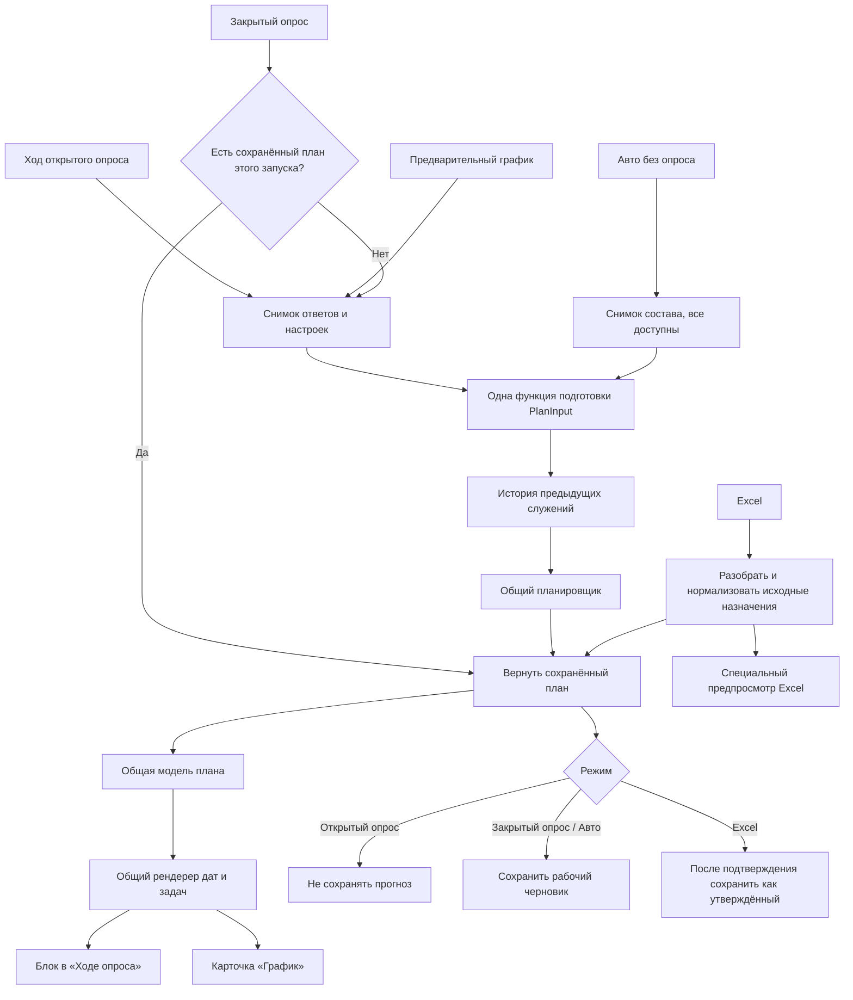

# Единая подготовка и отображение черновика графика

## Цель

Сделать предварительный график в «📊 Ход опроса» и в «📋 График» одним
и тем же прогнозом: при одинаковых ответах и настройках совпадают
назначения, структура по дням и подписи. Первый приложенный скриншот
задаёт желаемый формат блока графика: заголовок
«📋 Служение › График › Опрос › месяц», явный статус предварительного
расчёта и группировка задач по фактическим дням служения.

Документ фиксирует исходные причины расхождения, целевое поведение и
выполненную унификацию. Открытый опрос и предпросмотр графика используют
общую подготовку прогноза и общий форматтер; Excel по-прежнему импортируется
как исходный план без автоподбора.

## Как работало до изменений

### Открытый опрос: «📊 Ход опроса»

`show_readiness_progress` вызывает `readiness.summarize(..., with_plan=True)`,
а `progress_text` показывает результат `summary.plan`. Распределение
строится общим планировщиком, но этот путь не загружает историю
предыдущего месяца: `summarize` получает `last_served=None`.

Кроме того, `progress_text` форматирует план отдельно: перебирает даты
опроса (воскресенья) и печатает все задачи под воскресеньем. Для задачи
со своим днём это скрывает фактический день недели.

См. [handlers.py](../bot/handlers.py#L6337) и
[readiness.py](../bot/readiness.py#L362),
[readiness.py](../bot/readiness.py#L560).

### Открытый опрос: «Предварительный график»

Кнопка `pprev` вызывает `schedule_plan.build_draft(save=False)`. Эта
функция загружает `last_served`: сначала из утверждённого графика прошлого
месяца, а если его нет — из Excel. Затем она строит распределение через
`readiness.summarize` и `build_plan`. Черновик не сохраняется и не может
быть утверждён. При повторном нажатии прогноз строится заново по текущему
состоянию опроса.

Результат форматируется `schedule_plan.plan_text`: он группирует недели,
показывает фактические дни задач и включает нагрузку, интервалы, пропуски
и объяснения специальных отметок.

См. [handlers.py](../bot/handlers.py#L7444) и
[schedule_plan.py](../bot/schedule_plan.py#L214),
[schedule_plan.py](../bot/schedule_plan.py#L620).

### Почему одинаковые ответы дали разные назначения

Оба пути используют один базовый алгоритм распределения, но подготавливают
ему разные входные данные. Предпросмотр графика учитывает `last_served`,
а экран хода опроса — нет. История влияет на приоритеты участников и
интервалы между служениями, поэтому даже при одном наборе ответов
распределение может различаться.

Второе видимое расхождение — не расчёт, а отображение: в ходу опроса задача
со своим днём выводится под воскресеньем, тогда как в графике показывается
под фактическим днём. Если после открытия одного экрана пришёл новый ответ
или изменились настройки/состав, следующий пересчёт также закономерно
может дать другое распределение.

Итак, кнопки не сохраняют два конкурирующих графика в базе, но при
открытии каждой независимо получают временный результат; при этом текущие
пути различаются подготовкой истории и форматированием.

### Закрытый опрос и итоговый черновик

При завершении опроса `finish_run` вызывает `ensure_plan`. Если для этого
запуска план уже сохранён, повторно используется он; иначе `build_draft`
строит и сохраняет черновик. Этот рабочий план можно редактировать,
пересчитывать и утверждать.

См. [readiness.py](../bot/readiness.py#L1569) и
[schedule_plan.py](../bot/schedule_plan.py#L277).

### «Авто» без опроса

Действие `pfree` разрешено для месяца без опроса или с пропущенным опросом.
Оно создаёт `free_run`: все воскресенья месяца, без ответов. Тот же
`build_draft` вызывает `summarize(..., assume_free=True)`, учитывает историю
предыдущего месяца и сохраняет черновик. Настройка «Сначала ответившие» для
этого режима не применяется: автоматический график распределяет нагрузку
по всей команде.

См. [handlers.py](../bot/handlers.py#L7419) и
[schedule_plan.py](../bot/schedule_plan.py#L188),
[readiness.py](../bot/readiness.py#L362).

### Загрузка из Excel

Excel не распределяет людей автоматически. Бот читает лист, преобразует
назначения функцией `excel_plan`, показывает кандидата и после отдельного
подтверждения импортирует его как уже утверждённый график в базе. При
преобразовании сохраняются фактические дни задач и назначений; неизвестные
или неоднозначные имена остаются как текст и попадают в предупреждения.
Excel-кандидат не следует пропускать через алгоритм автоподбора: это
исказило бы исходное расписание.

Для меню и последующих действий Excel-план входит в ту же модель
`schedule_plans`, но строится другим способом. Его предварительный экран
сейчас использует `excel_text`, а не `plan_text`.

См. [handlers.py](../bot/handlers.py#L9102),
[schedule_plan.py](../bot/schedule_plan.py#L1132) и
[service_registry.py](../bot/service_registry.py#L7623).

## Реализованное решение

### Единый прогноз для расчётных режимов

Использовать одну точку входа подготовки графика, которая строит и возвращает
нормализованный объект черновика:

1. Получает неизменяемый снимок запуска опроса или режима «Авто»:
   даты, ответы и их порядок, состав и допуски, задачи и их параметры,
   настройки распределения, дни задач/участников, ограничения и историю
   предыдущих служений.
2. Для открытого опроса и «Авто» собирает `PlanInput` через одну и ту же
   подготовку данных. Отличается только источник доступности:
   - открытый опрос — реальные ответы плюс действующее правило для
     неответивших;
   - «Авто» — вся команда считается доступной, без опроса.
3. Один раз вызывает общий планировщик и получает объект с датами,
   задачами, назначениями, источником, статусом, статистикой и пояснениями.
4. Возвращает результат без записи в `schedule_plans` для предварительного
   просмотра. Для закрытого опроса и «Авто» результат сохраняется только
   в существующих точках жизненного цикла.
5. При неизменных входных данных оба экрана получают идентичные
   назначения. Новые ответы или изменения состава/настроек означают новый
   снимок и новый прогноз.

Отдельный сохранённый черновик для каждой кнопки не нужен. Также не
предлагается долговременный кэш открытого опроса: он рисковал бы показать
устаревшие ответы. Повторное открытие может пересчитать результат, но
обязательно через одну функцию и с одинаковой подготовкой входных данных.

### Единое представление

Вынести общую отрисовку блока графика в один рендерер. Он должен
использоваться как в предварительном предпросмотре, так и в сохранённом
графике по опросу/«Авто». Статус передавать параметром, а не менять готовый
текст через `str.replace`.

`📊 Ход опроса` сохраняет полезную информацию именно об опросе: срок,
напоминание, кто ответил, даты доступности и список ожидаемых ответов.
Его блок «Предварительный график» отображается общим рендерером и
совпадает с планом на экране «📋 График» при том же снимке ответов.
Задачи со своими днями в обоих местах находятся под правильным днём
недели.

Excel-кандидат сохраняет специальный предпросмотр для импорта в файл:
строки Excel, непривязанные имена, пропущенные дни и кнопки подтверждения.
Он использует нормализованные назначения, но не планировщик и не заменяет
их автоподбором.

### Явно различать источник

Для отображения использовать однозначный режим, выводимый из состояния
плана:

| Режим | Как определяется сейчас | Смысл |
|---|---|---|
| Опрос | `run_id` задан | Распределение по ответам; до завершения — только прогноз |
| Авто | `run_id` отсутствует, `source != "excel"` | Распределение без опроса |
| Excel | `source == "excel"` | Назначения из файла, без автоподбора |

До изменений подпись заголовка в `plan_text` определялась только по `run_id`,
поэтому Excel-план может получить заголовок «Авто». А строка источника в
`plan_source_line` для автоматически сохранённого плана может назвать его
графиком «по опросу». `plan_source_mode` теперь различает Excel, авто и
опрос при формировании заголовка и строки источника, не меняя утверждённую
политику источников.

## Предлагаемая структура экранов

### Открытый опрос — «📊 Ход опроса»

```text
📊 Ход опроса · ЗВУК · декабрь 2026
⏳ до 28.11 20:00
🔔 Напоминание: …

Ответили 4 из 7
Свободны: 02.12 — 3 · 06.12 — 3 · …
✅ Ответили: …
⏳ Не ответили: …

────────────────
📋 ЗВУК › График › Опрос › декабрь 2026
⏳ Предварительный — опрос идёт; после завершения график можно
поправить и утвердить.
Ответили 4 из 7 · закрыто мест 12 из 12

🗓 Неделя 30.11–06.12
   ср 02.12
      🎼 спевка
         • Имя
   вс 06.12
      🎚 звук
         • Имя
      🧰 сборка
         • Имя*
…

[🔄 Обновить прогноз]
[⬅️ К опросу]
```

Это один и тот же блок, который показывает кнопка предварительного графика.
В нём нет кнопок утверждения или редактирования, пока опрос открыт.

### Закрытый опрос или «Авто» — рабочий график

```text
📋 ЗВУК › График › Опрос › декабрь 2026
📝 Черновик — ещё не утверждён
Ответили 7 из 7 · закрыто мест 12 из 12

… тот же формат дат, задач и участников …

[✏️ Изменить] [🔄 Пересчитать]
[✅ Утвердить]
[⬅️ К опросу]
```

У «Авто» в заголовке показывается источник «Авто», а текст объясняет, что
все участники считались доступными. У утверждённого графика сохраняется
текущий статус и доступные действия.

### Excel-кандидат

```text
📥 ЗВУК · график из Excel · декабрь 2026
📝 Кандидат — ещё не подтверждён

… исходные назначения в общей структуре дат и задач …

⚪ Не привязаны к Telegram: …
⚠️ Пропущены даты вне воскресений: …

[✅ Подтвердить] [❌ Отмена]
```

Подтверждение сохраняет именно назначения из Excel и не запускает
автоподбор.

## Схема подготовки



## Выполненные изменения

1. `prepare_draft` возвращает график вместе со сводкой того же снимка
   ответов; открытый опрос и предпросмотр используют эту общую подготовку.
2. `show_readiness_progress` добавляет прогноз, подготовленный общим
   builder и отформатированный через `plan_text`.
3. Экран хода опроса и предпросмотр передают статус явно; отдельного
   форматирования назначений и подмены текста через `str.replace` нет.
4. `plan_source_mode` различает источники опроса, авто и Excel.
5. Excel по-прежнему преобразуется и подтверждается как исходный план, без
   автоподбора.
6. Примеры экранов и руководство администратора обновлены вместе с кодом.

## Критерии проверки

- При одинаковом открытом запуске, ответах, составе, настройках и истории
  блок назначений в «Ходе опроса» совпадает с предварительным графиком;
  это проверяется тестом обработчика.
- Изменение `last_served` одинаково влияет на оба экрана.
- Задача со своим днём показывается под фактическим днём в обоих экранах.
- Новый ответ меняет прогноз после обновления и его счётчик отражает
  использованный набор ответов.
- Прогноз открытого опроса не записывается и не утверждается.
- Закрытый опрос использует сохранённый план; явный пересчёт учитывает
  тот же общий builder и сохраняет существующее подтверждение сброса
  ручных правок.
- «Авто» учитывает всех участников доступными и историю служений,
  сохраняя черновик до утверждения.
- Импорт Excel сохраняет исходные назначения, не вызывает автоподбор
  и требует подтверждения.
